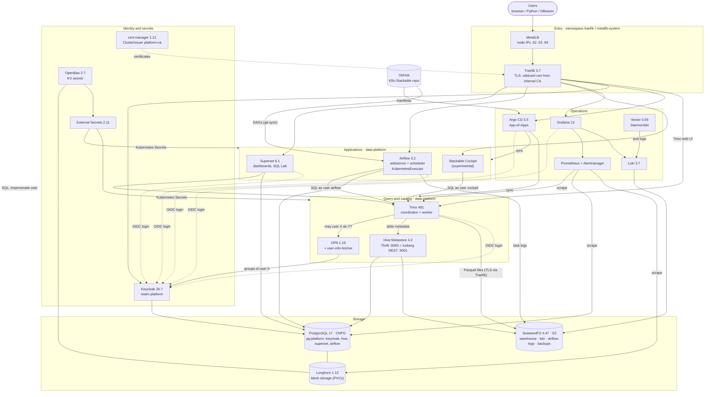
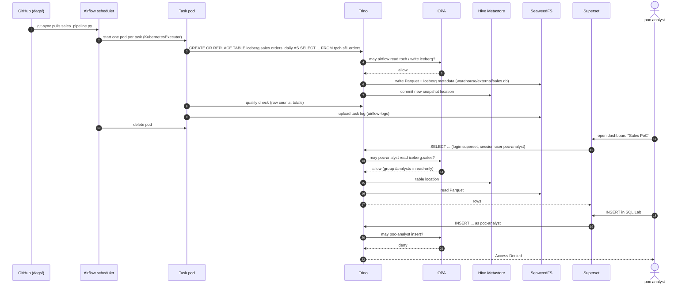
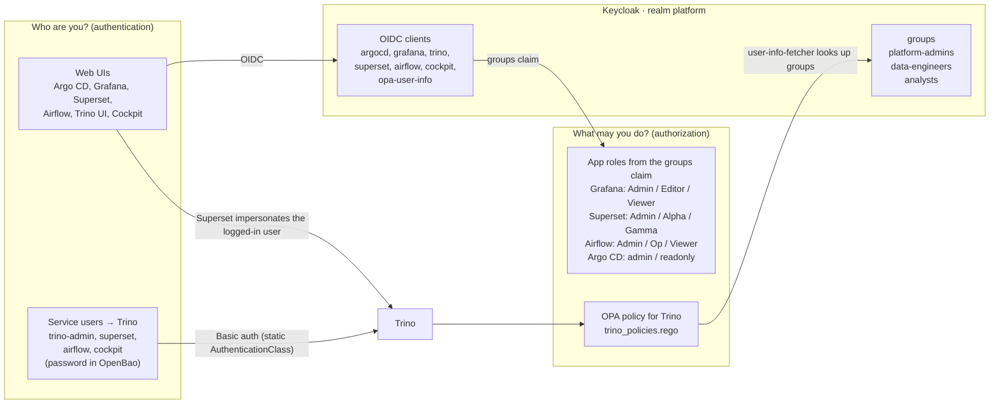
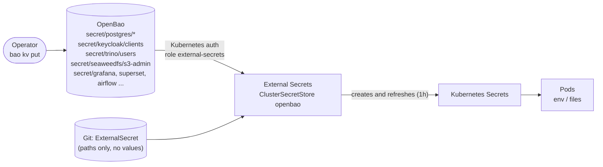
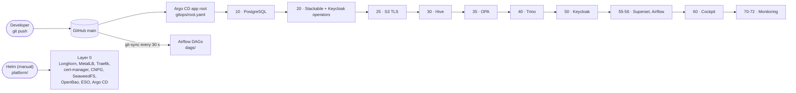

# Architecture

PoC data platform on Kubernetes (3 VMs, kubeadm 1.33) built with the Stackable Data Platform 26.7.
Diagrams are Mermaid and render on GitHub.

1. [Overview](#1-overview): every component and how they connect
2. [Data flow](#2-data-flow-sales_pipeline): one pipeline run, from DAG to dashboard
3. [Authentication and authorization](#3-authentication-and-authorization)
4. [Secrets](#4-secrets)
5. [Deployment (GitOps)](#5-deployment-gitops)
6. [Network entry points](#6-network-entry-points)

---

## 1. Overview

| Layer | Components | Installed by |
|---|---|---|
| Bootstrap (layer 0) | Longhorn, MetalLB, Traefik, cert-manager, CNPG operator, SeaweedFS, OpenBao, External Secrets, Argo CD | Helm (`platform/`) |
| Platform (layer 1) | PostgreSQL cluster, Stackable operators, Hive, Trino, OPA, Keycloak, Superset, Airflow, monitoring, Cockpit | Argo CD (`gitops/`) |

---

## 2. Data flow: `sales_pipeline`

One run of the end-to-end test DAG ([docs/test/e2e-test.md](test/e2e-test.md)).

---

## 3. Authentication and authorization

Data access is decided in one place: OPA, for every Trino query. Superset forwards the logged-in user to Trino (impersonation), so a dashboard shows only what that user's Keycloak group may read.

| Keycloak group | Trino (OPA) | Superset | Airflow | Grafana |
|---|---|---|---|---|
| `platform-admins` | everything | Admin | Admin | Admin |
| `data-engineers` | read/write `iceberg`, read others | Alpha + sql_lab | Op | Editor |
| `analysts` | read-only | Gamma + sql_lab + trino_access | Viewer | Viewer |
| no group | `system` catalog only | Public | Public | Viewer |

---

## 4. Secrets

- The Git repo is public. It holds only `ExternalSecret` objects that name OpenBao paths, never values.
- One OpenBao value can feed both sides of a connection. For example, `secret/trino/users` `airflow` becomes Trino's password file *and* Airflow's `trino_default` connection.
- Not in OpenBao: the OpenBao unseal keys (`init-keys.json` on the control-plane node) and keys generated by operators (`superset-secret-key`, `airflow-fernet-key`).

---

## 5. Deployment (GitOps)

Each Application waits until the previous wave is Healthy (custom health check for `Application` in `argocd-cm`).

---

## 6. Network entry points

All URLs are `https://<name>.172.19.10.62.sslip.io`. TLS ends at Traefik with a wildcard certificate from the internal CA (`platform-ca`).

| Host | Service | Login |
|---|---|---|
| `argocd` | Argo CD | Keycloak |
| `keycloak` | Keycloak | realm `master` for admins, `platform` for users |
| `grafana` | Grafana | Keycloak |
| `superset` | Superset | Keycloak |
| `airflow` | Airflow | Keycloak |
| `trino` | Trino web UI | Keycloak |
| `cockpit` | Stackable Cockpit | Keycloak |
| `longhorn` | Longhorn UI | basic auth |
| `s3` | SeaweedFS S3 API | S3 keys |

Inside the cluster, clients reach Trino at `trino-coordinator.data-platform.svc.cluster.local:8443` (HTTPS, password) and S3 at `seaweedfs-s3.seaweedfs.svc:8333` (HTTP) or `s3-tls.seaweedfs.svc.cluster.local:443` (HTTPS, required by Stackable products).
